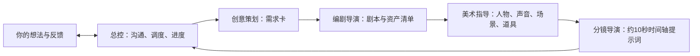

# AIGC 制作总控

把“我想做一个 AI 短片”逐步变成创作需求、按需剧本、一致的资产设定和可复制的视频提示词。

**一个总控 + 四个专业子 Agent。先沟通、按阶段确认，再继续制作。**

适合做商业美食片、剧情短片或纪录内容的创作者。图片提示词英文，Seedance 视频提示词中文；你掌握方向和素材生成。

**先看示例：** [30秒虚构面馆宣传片：从想法到提示词](examples/noodle-shop-demo.md)。含需求卡、剧本选择、英文资产提示词、3段中文分镜和进度记录；这是文字演示，不是已生成成片。

**立即试用：** 下载 [v1.0.0 稳定版](https://github.com/yy879910025-rgb/aigc-production/releases/tag/v1.0.0)，按下方步骤安装，然后输入：

> 使用 $aigc-production，我想制作一个30秒美食宣传片。先和我确认选题、受众、表达目的与影片画幅。

已有剧本或素材也能接续，不必从头填写。

## 分工

|角色|交付|
|---|---|
|总控|需求确认、调度、版本与进度管理|
|创意策划|创作需求卡|
|编剧与导演|按需剧本、资产清单|
|电影美术指导|人物/声音/场景/道具设定、英文生图提示词|
|分镜导演|约10秒的中文时间轴视频提示词|

用户负责实际生成媒体，本技能不会自动调用图片或视频生成服务。独立子 Agent 需要执行环境支持；不支持时说明限制并取得用户同意后按角色代行。

## 安装与使用

下载已发布版本，将包含 SKILL.md、agents、references、assets 的目录命名为 aigc-production，复制到自己的 Codex skills 目录。已有同名技能时先备份再决定替换。不要将 GitHub 开发仓库直接绑定到正在使用的技能目录。

调用示例：`使用 $aigc-production，我想制作一个 AI 短片，从选题沟通开始。`

更新采用手动选择版本、检查、测试、确认后替换，不提供自动更新脚本。

## 贡献

欢迎 Fork 后通过 Pull Request 提交改进。仓库所有者审核决定是否合并，不自动合并。详见 CONTRIBUTING.md。

## 验证范围

已完成技能结构检查及一次真实创意策划子 Agent 调度测试；缺图接续和服装变更规则完成静态检查。未验证所有平台兼容性、完整四阶段制作或实际媒体效果。运行 `python3 .github/validate.py` 可做文件结构检查，不能替代行为评审。当前未启用 GitHub Actions 自动检查。

## 许可

MIT License。发布内容仅含通用技能规则及头像，不含个人项目素材和私人记忆。
